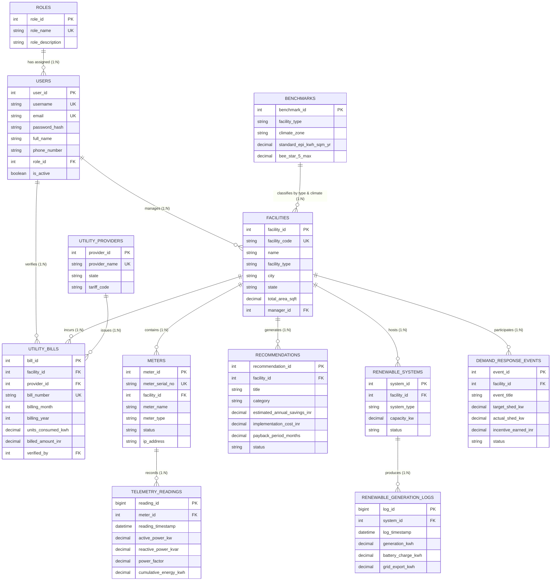

# GreenGrid: Entity Relationship (ER) Summary
## Relational Database Schema (3NF) - MySQL 8.0

---

## 1. ER Diagram (Mermaid)

---

## 2. Table Relationships (Cardinality Breakdown)

| Parent Table | Child Table | Relationship | Description | Foreign Key Constraint |
| :--- | :--- | :--- | :--- | :--- |
| `roles` | `users` | **1 : N (One-to-Many)** | One role (Admin, Manager, Engineer) can be assigned to multiple users. | `fk_users_role` (`ON DELETE RESTRICT`) |
| `users` | `facilities` | **1 : N (One-to-Many)** | A facility manager can oversee multiple facilities. | `fk_facilities_manager` (`ON DELETE SET NULL`) |
| `facilities` | `meters` | **1 : N (One-to-Many)** | A facility houses multiple sub-meters (Chillers, Incomers, UPS, Solar). | `fk_meters_facility` (`ON DELETE CASCADE`) |
| `meters` | `telemetry_readings` | **1 : N (One-to-Many)** | One meter streams thousands of time-series readings. | `fk_telemetry_meter` (`ON DELETE CASCADE`) |
| `utility_providers` | `utility_bills` | **1 : N (One-to-Many)** | A utility Discom (e.g. BESCOM) issues bills to multiple facilities. | `fk_bills_provider` (`ON DELETE RESTRICT`) |
| `facilities` | `utility_bills` | **1 : N (One-to-Many)** | Each facility receives monthly bills over multiple fiscal years. | `fk_bills_facility` (`ON DELETE RESTRICT`) |
| `users` | `utility_bills` | **1 : N (One-to-Many)** | A manager verifies/approves multiple utility invoices. | `fk_bills_verifier` (`ON DELETE SET NULL`) |
| `facilities` | `recommendations` | **1 : N (One-to-Many)** | An energy audit produces multiple efficiency retrofit recommendations. | `fk_recs_facility` (`ON DELETE CASCADE`) |
| `facilities` | `renewable_systems` | **1 : N (One-to-Many)** | A facility can operate rooftop solar, BESS batteries, and wind systems. | `fk_renewables_facility` (`ON DELETE CASCADE`) |
| `renewable_systems` | `renewable_generation_logs` | **1 : N (One-to-Many)** | Each renewable asset logs generation and net-metering telemetry. | `fk_renlogs_system` (`ON DELETE CASCADE`) |
| `facilities` | `demand_response_events` | **1 : N (One-to-Many)** | A facility participates in scheduled grid demand-response events. | `fk_drevents_facility` (`ON DELETE CASCADE`) |
| `benchmarks` | `facilities` | **Conceptual 1 : N** | Standard BEE performance standards classify facilities by type and climate. | Lookup via `facility_type` |

---

## 3. Normal Form Compliance (3NF Analysis)
1. **1NF (First Normal Form)**:
   - All columns contain atomic, indivisible values.
   - Every table possesses an explicit primary key (`role_id`, `user_id`, `facility_id`, etc.).
   - No repeating groups or comma-delimited arrays exist.

2. **2NF (Second Normal Form)**:
   - Full functional dependency: All non-key attributes depend completely on the primary key, with no partial dependencies on compound keys.

3. **3NF (Third Normal Form)**:
   - No transitive dependencies: Non-key attributes depend only on the primary key and not on other non-key attributes. For example, utility provider details (`tariff_code`, `customer_care_no`) reside in `utility_providers`, not repeated redundantly in `utility_bills`.
